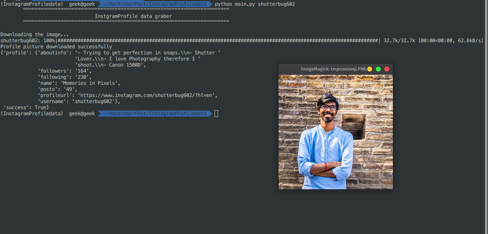

## Instgram profile information

### install packages 
```
pip install -r requirements.txt
```

### Execute Program
```
python InstgramProfile.py <username>
```

### Sample run 




## Author
Developed by [spghimire](https://github.com/Codebymanish26).

## License
This project is licensed under the MIT License - see the [LICENSE](LICENSE) file for details.
